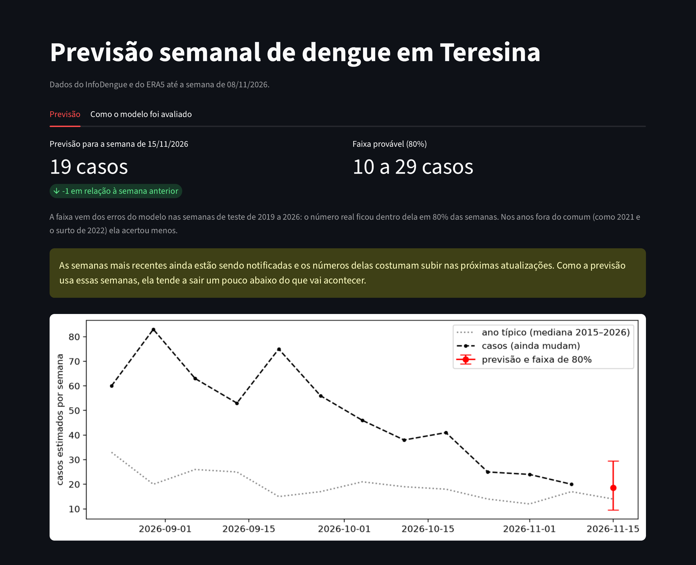

# Previsão de dengue em Teresina

Modelo que prevê os casos de dengue da semana seguinte em Teresina (PI), com dados públicos do InfoDengue e clima do ERA5, e um dashboard em Streamlit com a previsão e a avaliação do modelo.

**Dashboard no ar: [dengue-teresina.streamlit.app](https://dengue-teresina.streamlit.app/)**

[](https://dengue-teresina.streamlit.app/)

## Resultado

Testei o modelo ano a ano, de 2019 a 2026: cada ano é previsto por um modelo treinado só com os anos anteriores. A comparação é com o baseline, que diz que a semana que vem vai ter os mesmos casos desta.

| modelo | MAE | RMSE |
|---|---|---|
| baseline (semana anterior) | 27,9 | 62,7 |
| **regressão linear** (casos das 4 últimas semanas + época do ano) | **26,8** | **59,8** |

Erro em casos por semana, nas 391 semanas de teste.

- O ganho é pequeno (4,2% no MAE) e fica nos surtos: em 2022 o modelo errou 73,0 casos por semana, contra 83,9 do baseline, e em 2026, 54,9 contra 61,9. Nos anos calmos (2020, 2021 e 2025) ele perde.
- O clima (chuva acumulada e umidade) não melhorou a previsão de uma semana: o que ele traz já está nos casos recentes e na época do ano.
- Também testei o alvo em log e um Gradient Boosting. Os dois ficaram piores que a regressão linear, que ainda tem a vantagem de dar pra explicar cada peso.

O dashboard tem duas abas: a previsão da próxima semana, com uma faixa de 80%, e a avaliação, com o erro de cada ano e todos os modelos testados.

## Dados

- **[InfoDengue](https://info.dengue.mat.br/services/api)**: casos semanais de Teresina, de janeiro de 2015 a novembro de 2026, pela API pública.
- **[ERA5 via Open-Meteo](https://open-meteo.com/en/docs/historical-weather-api)**: chuva, temperatura e umidade de hora em hora, de 2015 a novembro de 2026. É o clima usado no modelo.
- **[INMET](https://portal.inmet.gov.br/dadoshistoricos)**: as mesmas três variáveis, medidas pela estação automática de Teresina (A312), de 2015 a setembro de 2026. Usada para conferir o ERA5.

O InfoDengue também tem dados de clima, mas só a partir de junho de 2023 e sem chuva.

## Decisões

- **Horizonte:** uma semana à frente. Depois, a ideia é chegar a quatro.
- **Alvo:** `casos_est`, a estimativa do InfoDengue que corrige o atraso das notificações.
- **Semanas em aberto:** as 20 mais recentes ficam fora do treino e da avaliação, porque os números delas ainda mudam. Comparando dois downloads, semanas com até 11 semanas de idade subiram de 23% a 87%, e só a partir de 16 semanas o número parou de mudar.
- **Sem indicadores do InfoDengue:** `Rt` e nível de alerta são calculados a partir dos próprios casos e dariam ao modelo uma dica da resposta.
- **Clima do ERA5 no período todo:** a estação A312 ficou parada por cerca de 18 meses, e a relação de chuva entre as duas fontes muda de ano para ano (em 2015 o ERA5 marcou 85% a mais que a estação; em 2022, 32% a menos). Emendar as duas criaria degraus falsos no clima.
- **Avaliação em janela móvel anual:** com um corte único entre treino e teste, o surto de 2022 ficaria sempre no treino. Assim, 2022 e 2026 viram anos de teste.
- **Uma coisa por vez:** cada modelo acrescenta uma só mudança em relação ao anterior, sempre nas mesmas semanas, pra saber exatamente o que fez o erro mudar.

O porquê de cada uma, e o que eu conferi nos dados antes de decidir, está em [docs/decisoes.md](docs/decisoes.md).

## Limitações

- **O erro real deve ser maior que o medido.** Na avaliação, as semanas anteriores aparecem com o número já revisado, que não existia na hora da previsão. Como as semanas recentes chegam a subir até 87% depois, o modelo e o baseline parecem melhores do que seriam no uso real. Pra medir isso, passei a guardar uma foto de cada download em `data/raw/infodengue_fotos/`.
- **A previsão do dashboard tende a sair baixa,** porque usa as 4 últimas semanas, que ainda estão sendo notificadas.
- **O ganho sobre o baseline é pequeno** e não acontece em todos os anos.
- **O clima vem de uma grade de ~25 km**, que suaviza a chuva localizada.
- **O dashboard usa uma cópia fixa dos dados**, não a API ao vivo.

## Como rodar

O dashboard está publicado no [Streamlit Community Cloud](https://dengue-teresina.streamlit.app/). Para rodar na sua máquina:

```bash
git clone https://github.com/jvictor-melo/dengue-teresina-ml.git
cd dengue-teresina-ml

python -m venv .venv
.venv\Scripts\Activate.ps1        # no Linux/macOS: source .venv/bin/activate

pip install -r requirements.txt

streamlit run app/app.py          # dashboard
jupyter notebook                  # notebooks
```

Os dados e o modelo treinado já estão no repositório, então o dashboard abre direto. Os notebooks rodam em ordem; os ZIPs completos do INMET (cerca de 100 MB por ano) ficam de fora, só o CSV da estação de Teresina é versionado.

## Estrutura

```
data/raw/          dados brutos, sem alteração (e uma foto de cada download do InfoDengue)
data/processed/    dados tratados pelos notebooks
notebooks/         01_coleta, 02_limpeza, 03_clima, 04_eda, 05_baseline, 06_modelos
src/               features e regras de avaliação, usadas pelos notebooks e pelo dashboard
models/            modelo final, ficha do modelo e resultados da avaliação
app/               dashboard em Streamlit
docs/              decisões e conferências
```

## Próximos passos

- Prever de 1 a 4 semanas à frente, com um modelo para cada horizonte
- Refazer a avaliação com as fotos dos downloads, usando os números que existiam em cada semana

## Sobre o uso de IA

O planejamento é meu: defini o problema, o horizonte, o alvo, a regra das semanas em aberto e o roteiro das etapas. Usei o Claude Code como copiloto dentro desse plano. Ele escreveu boa parte do código e rascunhou parte dos textos dos notebooks e da documentação, e em cada passo levantava os riscos e as alternativas. Eu escolhia o caminho, rodava, conferia os números e revisava os textos antes de seguir. As decisões e os commits são meus.

Na prática, foi conferindo o dado que algumas decisões mudaram: as semanas em aberto passaram de 10 para 20 depois de comparar dois downloads da API, o ERA5 virou a fonte do clima depois de medir que a estação do INMET tinha ficado parada por um ano e meio, e a limitação da avaliação ganhou número depois de ver semanas subindo até 87% entre um download e outro.

## Créditos dos dados

Casos: [InfoDengue](https://info.dengue.mat.br/). Clima: [INMET](https://portal.inmet.gov.br/) e ERA5 via [Open-Meteo](https://open-meteo.com/) (Zippenfenig, 2023), gerado com informações do Copernicus Climate Change Service.

---

João Victor Macêdo de Melo · [LinkedIn](https://www.linkedin.com/in/jvictor-melo) · [GitHub](https://github.com/jvictor-melo)
